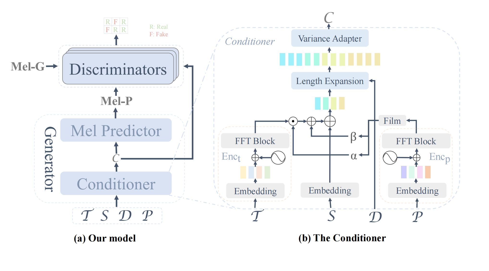

# Síntesis de Ópera de Gezi
La implementación oficial de nuestro artículo AAAI24: *FT-GAN: Fine-grained Tune Modeling for Chinese Opera Synthesis*.

## :card_file_box: Entornos y Dataset
1. Cree un entorno con anaconda, por ejemplo:
```bash
conda create -n gezi_opera python=3.8
conda activate gezi_opera
git clone https://github.com/double-blind-pseudo-user/Gezi_opera_synthesis
cd Gezi_opera_synthesis
pip install -r requirements.txt
```
2. Descargue el [vocoder](https://github.com/MoonInTheRiver/DiffSinger/releases/download/pretrain-model/0109_hifigan_bigpopcs_hop128.zip) y el [extractor de pitch](https://github.com/MoonInTheRiver/DiffSinger/releases/download/pretrain-model/0102_xiaoma_pe.zip) preentrenado, descomprima estos dos archivos en `checkpoints` antes de entrenar su modelo acústico.
3. Descargue el [dataset](https://github.com/zhengmidon/Gezi-Opera-Synthesis/tree/master/data) y descomprímalo en `data/processed`.

## :page_facing_up: Preprocesamiento
Ejecute los siguientes scripts para binarizar los datos:
```shell
export PYTHONPATH=.
CUDA_VISIBLE_DEVICES=0 nohup python data_gen/tts/bin/binarize.py \
--config usr/configs/gezixi.yaml \
> data_processing.log 2>&1 &
```
Los datos binarizados se guardarán en `data/binary`.

## :pencil2: Entrenamiento
Ejecute los siguientes scripts para entrenar el modelo:
```shell
CUDA_VISIBLE_DEVICES=0 nohup python tasks/run.py \
--config usr/configs/gezixi.yaml --exp_name your_experiments_name --reset \
> training.log 2>&1 &
```
## :loud_sound: Inferencia
Una vez finalizado el entrenamiento, ejecute los siguientes scripts para generar audio:
```shell
CUDA_VISIBLE_DEVICES=0 nohup python tasks/run.py \
--config usr/configs/gezixi.yaml --exp_name your_experiment_name --reset --infer \
> inference.log 2>&1 &
```
Los resultados de la inferencia se guardarán en `checkpoints/your_experiment_name/generated_` por defecto.
